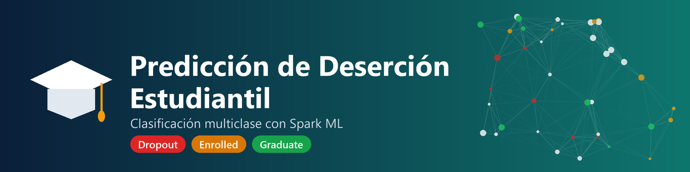

# 🎓 Predicción de Deserción Estudiantil con Spark ML



**Autor:** Santiago Caicedo Ortiz · **ID:** U00165112
**Examen de Big Data – Spark ML · Parte 2: clasificación multiclase**

🔗 **App desplegada:** _(pega aquí la URL pública de Streamlit Community Cloud)_

## Descripción
Una universidad quiere identificar de forma temprana a los estudiantes en riesgo de deserción y a los que van
camino a graduarse. Este proyecto entrena con **Spark ML** un modelo que clasifica a cada estudiante en una de
tres clases y lo publica en una aplicación web con **Streamlit**:

| Clase | Significado |
|---|---|
| `Dropout` | El estudiante abandona sus estudios |
| `Enrolled` | Sigue matriculado sin haberse graduado |
| `Graduate` | Se gradúa |

**Datos:** [Predict Students' Dropout and Academic Success](https://www.kaggle.com/datasets/thedevastator/higher-education-predictors-of-student-retention)
(Kaggle). Son 4.424 estudiantes y 34 variables demográficas, socioeconómicas y de rendimiento académico. Las
clases están desbalanceadas: Graduate ≈ 50 %, Dropout ≈ 32 %, Enrolled ≈ 18 %.

## Metodología (notebook)
El notebook [`notebook/parcial_spark_ml.ipynb`](notebook/parcial_spark_ml.ipynb) está organizado en tres secciones:

- **A. Carga, limpieza, features y partición:** `SparkSession`, lectura del CSV, normalización de nombres de
  columnas con regex, eliminación de duplicados y nulos, indexado de `Target` con `StringIndexer` (fuera del
  pipeline) y partición 80/20 con semilla 42. Variables derivadas:
  - `tasa_aprobacion_1s`, `tasa_aprobacion_2s`: aprobadas / inscritas.
  - `variacion_nota`: nota del 2.º semestre − nota del 1.º.
  - `eficiencia_evaluacion_2s`: aprobadas / evaluadas.

  Selección de variables con `featureImportances`.
- **B. Pipelines e hiperparámetros:** `StringIndexer` → `OneHotEncoder` → `VectorAssembler` → `StandardScaler`
  → clasificador, para `LogisticRegression` (multinomial), `RandomForestClassifier` y
  `DecisionTreeClassifier`. Cada uno se ajusta con `ParamGridBuilder` + `CrossValidator` (3 folds, F1).
- **C. Evaluación:** accuracy, F1, precisión y recall ponderados sobre el conjunto de prueba, matriz de
  confusión y comparación de los tres modelos. El mejor se guarda en `modelo_final/`.

**Desbalance:** pesos por clase (`weightCol`, inversamente proporcionales a la frecuencia) y F1 ponderado como
métrica de selección.

## La aplicación
`app.py` carga el `PipelineModel` con `PipelineModel.load` y mantiene Spark y el modelo en memoria con
`@st.cache_resource`. Muestra un formulario (`st.form`) con las variables del modelo, calcula las variables
derivadas, convierte los datos en un DataFrame de Spark y muestra la **clase predicha** y la **probabilidad de
cada clase**, en un gráfico y una tabla.

## Estructura del repositorio
```
├── app.py                  # aplicación Streamlit
├── modelo_final/           # PipelineModel de Spark + metadata.json (labels y variables)
├── assets/banner.png       # banner de la app
├── notebook/parcial_spark_ml.ipynb
├── requirements.txt        # streamlit, pyspark, pandas
├── packages.txt            # default-jre (Java para Spark en Streamlit Cloud)
└── .streamlit/config.toml  # tema de colores
```

## Cómo ejecutarla
### En local
Requiere Python 3.10–3.12 y **Java 17 o 21** instalado (Spark 4).
```bash
pip install -r requirements.txt
streamlit run app.py
```
La app se abre en http://localhost:8501.

### Entrenar de nuevo el modelo
Abre `notebook/parcial_spark_ml.ipynb` en Google Colab y ejecuta todo (**Entorno de ejecución → Ejecutar todo**).
El dataset se descarga solo con `kagglehub`. Al final se descarga `modelo_final.zip`: descomprímelo en la raíz
del repositorio.

### En Streamlit Community Cloud
1. Sube este repositorio a GitHub (debe incluir la carpeta `modelo_final/`).
2. En [share.streamlit.io](https://share.streamlit.io) elige **Create app**, selecciona el repositorio, la rama
   `main` y el archivo `app.py`.
3. `packages.txt` instala Java automáticamente y `requirements.txt` instala las librerías de Python.
